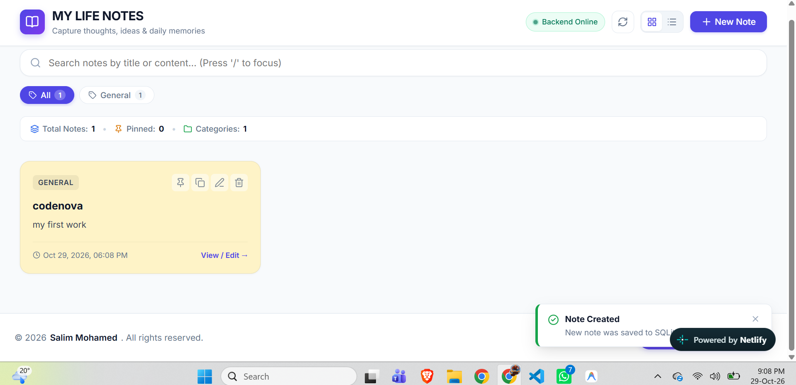
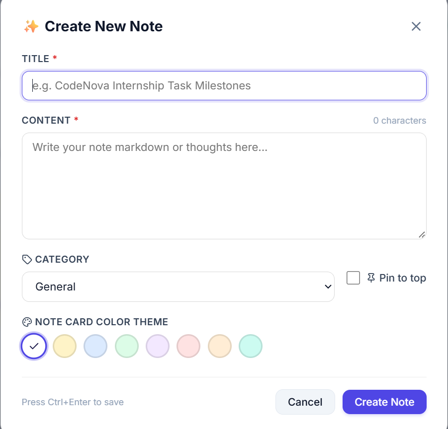

# MY LIFE NOTES - Notes Application (Task 1)

> **CodeNova Full Stack Internship - Batch 01**
> Remote / Online | 4 Weeks Self-Paced | Deadline: 06 November 2026

A full-stack notes manager where you can create, edit, pin, color-code, and search your personal notes in real time. Built with React 19 on the frontend and Express + PostgreSQL on the backend.

---

## Screenshots





---

## Tech Stack

| Layer | Technology | Details |
| :--- | :--- | :--- |
| **Frontend** | React 19 + Vite | Fast HMR, modular component architecture, Lucide icons |
| **Styling** | Modern CSS | Responsive Grid/Flexbox, custom color palettes, glassmorphism |
| **Backend** | Node.js + Express | RESTful API, route & controller separation, Morgan logger |
| **Database** | PostgreSQL (`pg`) | Hosted with Supabase and managed through SQL migrations |
| **State Sync** | React Hooks & Async Fetch | Instant UI updates, debounced search, graceful toasts |

---

## Features

- **Full CRUD** — Create, read, update, and delete notes with immediate backend sync
- **Instant Search** — Real-time filtering across titles and content with match highlighting
- **Category Taxonomy** — Filter by `Work`, `Study`, `Personal`, `Ideas`, `Urgent`, or custom categories
- **Note Pinning** — Pin important notes to a dedicated top section
- **Color Theming** — 8 pastel color themes per note for visual organization
- **Dual View Modes** — Switch between Card Grid and compact List view
- **Offline Detection** — Live backend health indicator with warning banner if server is unreachable
- **Toast Notifications** — Non-intrusive animated alerts for every operation
- **Keyboard Shortcuts**
  - `/` or `Ctrl+K` — Focus search
  - `c` — Open new note modal (when not typing)
  - `Ctrl+Enter` — Save note
  - `Escape` — Close modal

---

## Project Structure

```text
task1-notes-app/
├── backend/
│   ├── database/
│   │   ├── schema.sql        # PostgreSQL table reference
│   │   ├── migrations/       # Controlled, repeatable migrations
│   │   ├── seed.js           # Sample data seeder
│   └── src/
│       ├── controllers/
│       │   └── notesController.js
│       ├── routes/
│       │   └── notes.js
│       ├── db.js
│       └── server.js
├── frontend/
│   └── src/
│       ├── components/
│       │   ├── CategoryFilter.jsx
│       │   ├── EmptyState.jsx
│       │   ├── Footer.jsx
│       │   ├── Navbar.jsx
│       │   ├── NoteCard.jsx
│       │   ├── NoteModal.jsx
│       │   ├── SearchBar.jsx
│       │   ├── StatsBar.jsx
│       │   └── Toast.jsx
│       ├── services/
│       │   └── api.js
│       ├── App.jsx
│       ├── App.css
│       └── index.css
├── screenshort.png
├── screenshort2.png
└── README.md
```

---

## Database Schema

```sql
CREATE TABLE IF NOT EXISTS notes (
  id integer GENERATED BY DEFAULT AS IDENTITY PRIMARY KEY,
  title text NOT NULL,
  content text NOT NULL,
  category text NOT NULL DEFAULT 'General',
  is_pinned boolean NOT NULL DEFAULT false,
  color text NOT NULL DEFAULT '#ffffff',
  created_at timestamptz NOT NULL DEFAULT CURRENT_TIMESTAMP,
  updated_at timestamptz NOT NULL DEFAULT CURRENT_TIMESTAMP
);
CREATE INDEX IF NOT EXISTS idx_notes_title ON notes(title);
CREATE INDEX IF NOT EXISTS idx_notes_updated_at ON notes(updated_at DESC);
```

---

## API Reference

**Base URL:** `http://localhost:5000/api`

| Method | Endpoint | Description |
| :--- | :--- | :--- |
| `GET` | `/health` | Health check |
| `GET` | `/notes` | List notes — supports `?search=`, `?category=`, `?pinned=1` |
| `GET` | `/notes/categories` | All distinct categories |
| `GET` | `/notes/:id` | Single note by ID |
| `POST` | `/notes` | Create note |
| `PUT` | `/notes/:id` | Update note |
| `PATCH` | `/notes/:id/pin` | Toggle pin |
| `DELETE` | `/notes/:id` | Delete note |

---

## Local Setup

### Prerequisites
- Node.js v22+
- npm

### Backend (port 5000)

```bash
cd task1-notes-app/backend
npm install
cp .env.example .env
npm run migrate
npm run dev
# API running at http://localhost:5000
```

### Frontend (port 3000)

```bash
cd task1-notes-app/frontend
npm install
npm run dev
# Open http://localhost:3000
```

### From the repo root

```bash
npm run seed:task1      # Seed the database with sample notes
npm run backend:task1   # Start backend  → http://localhost:5000
npm run frontend:task1  # Start frontend → http://localhost:3000
```

### Database (Deployment)

The application uses Supabase PostgreSQL. Set `DATABASE_URL` in the backend environment.
See `DATABASE_SETUP.md` for local and Render configuration instructions.

---

## Deployment

| Target | Platform | Config |
| :--- | :--- | :--- |
| Frontend | Vercel | Base: `frontend`, Build: `npm run build`, Output: `dist`, Env: `VITE_API_URL` |
| Backend | Render | Root: `backend`, Start: `npm start`, Env: `DATABASE_URL` |

---

## Acceptance Criteria

- [x] Client & server CRUD fully synchronized with PostgreSQL
- [x] Live search and category filtering
- [x] Card / List view toggle — responsive across all screen sizes
- [x] Network failure handled gracefully — no crashes, toast + banner shown
- [x] Server-side validation rejects empty titles/content with HTTP 400
